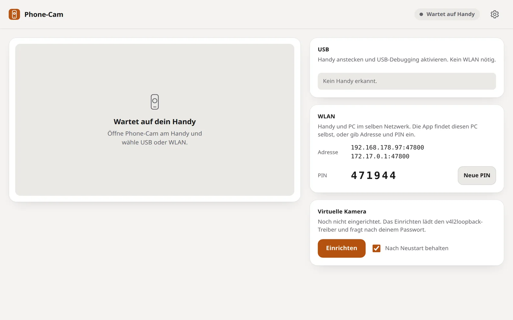
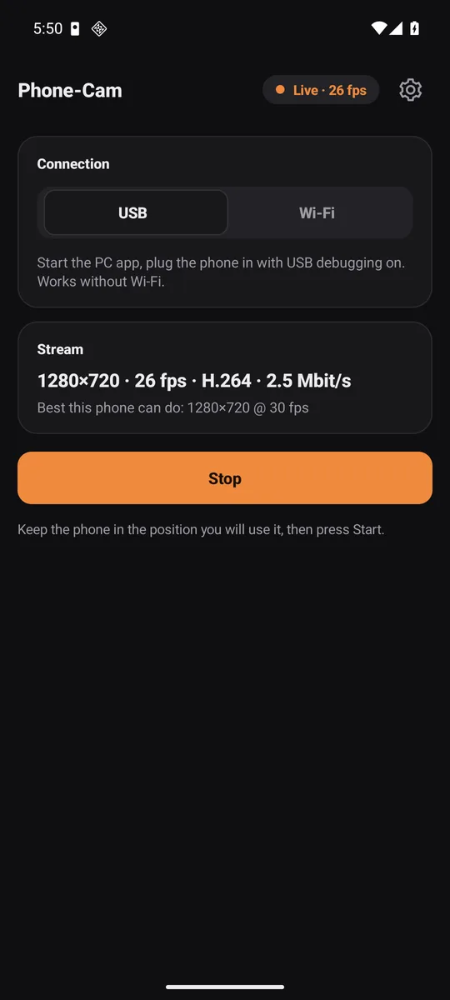
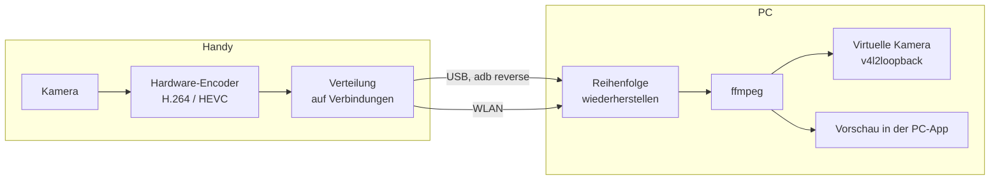

<div align="center">


# Phone-Cam

**Dein Handy als echte Webcam am PC.**<br>
Per USB-Kabel, WLAN oder beidem gleichzeitig. Verschlüsselt. Bis 4K mit 60 fps.

[](https://github.com/Emre1001/Phone-Cam/releases/latest)
[](LICENSE)


[Download](https://github.com/Emre1001/Phone-Cam/releases/latest) · [Website](https://emre1001.github.io/Phone-Cam/) · [Protokoll](docs/PROTOCOL.md)

</div>

<br>

<picture>
  <source media="(prefers-color-scheme: dark)" srcset="site/img/pc-dark-1600.webp">
  
</picture>

## Was Phone-Cam macht

Eine App am Handy filmt, eine App am PC empfängt. Der PC stellt das Bild als Kamera **„Phone-Cam“** bereit, die du in Zoom, OBS, Meet, Discord oder jeder anderen Video-App auswählst.

- **USB, WLAN oder beides**: Über USB braucht es weder WLAN noch PIN. Mit *USB + WLAN* laufen beide Wege gleichzeitig: mehr Bandbreite, und fällt einer aus, läuft der andere weiter.
- **Bis 4K bei 60 fps**: Die Handy-App fragt Kamera und Hardware-Encoder und nimmt den besten Modus, den beide schaffen, automatisch bis 1080p (1440p und 4K lassen sich wählen). HEVC, wenn möglich, sonst H.264. Liefert ein Modus auf deinem Handy kein Bild, schaltet die App selbst eine Stufe herunter.
- **Flüssig**: USB hat Vorrang, WLAN springt ein. Bei Engpässen senkt das Handy die Bitrate und hebt sie wieder an, sobald die Verbindung mitkommt. Tote Verbindungen werden nach Sekunden erkannt und neu aufgebaut.
- **Verschlüsselt**: Jede Verbindung nutzt ECDH P-256 und AES-256-GCM. Der PC weist sich mit einem eigenen Schlüssel aus, das Handy merkt ihn sich.
- **Klein**: Die PC-App ist eine einzige Datei mit rund 700 KB, ohne Electron. Die Handy-App hat unter 200 KB.
- **Ruhig**: Hell, Dunkel oder wie das System. Deutsch, English, Türkçe. Updates kommen aus den GitHub Releases.

## Download

| Datei | Für | Braucht |
|---|---|---|
| [`phone-cam-pc-linux-x86_64`](https://github.com/Emre1001/Phone-Cam/releases/latest/download/phone-cam-pc-linux-x86_64) | PC, Linux | `ffmpeg`, für USB `adb` |
| [`phone-cam-pc-windows-x86_64.exe`](https://github.com/Emre1001/Phone-Cam/releases/latest/download/phone-cam-pc-windows-x86_64.exe) | PC, Windows | `ffmpeg`, für USB `adb` |
| [`phone-cam-android.apk`](https://github.com/Emre1001/Phone-Cam/releases/latest/download/phone-cam-android.apk) | Handy | Android 8 oder neuer |

Die PC-App öffnet ihre Oberfläche in einem Chrome-, Edge- oder Chromium-Fenster, das schon installiert ist. Ohne einen dieser Browser öffnet sie sich im Standardbrowser.

## Schnellstart

**1. PC vorbereiten** (Linux, Debian/Ubuntu):

```bash
sudo apt install ffmpeg adb
```

```bash
chmod +x phone-cam-pc-linux-x86_64 && ./phone-cam-pc-linux-x86_64
```

In der PC-App unter *Virtuelle Kamera* einmal **Einrichten** klicken. Das lädt den Treiber `v4l2loopback` und fragt nach deinem Passwort.

**2. Handy verbinden**: Handy-App installieren und öffnen, dann eine Verbindung wählen:

| Verbindung | So geht es |
|---|---|
| **USB** | USB-Debugging einschalten (*Einstellungen*, *Über das Telefon*, 7 mal auf *Build-Nummer*, dann *Entwickleroptionen*). Kabel stecken, die Anfrage am Handy bestätigen. Die PC-App richtet alles selbst ein und kann die Handy-App per Knopf starten. |
| **WLAN** | Handy und PC im selben Netz. Die App findet den PC selbst. PIN aus der PC-App eingeben. Beim ersten Mal zeigt das Handy einen Schlüssel: Er muss mit dem *Schlüssel* in der PC-App übereinstimmen. |
| **USB + WLAN** | Kabel stecken und WLAN an. Das Handy startet über USB und nimmt WLAN als zweiten Weg dazu. |

**3. Starten**: Handy so halten, wie du es nutzt, dann **Starten**. In deiner Video-App die Kamera **Phone-Cam** wählen.

<p align="center">
  
</p>

## Stand

| | Linux | Windows |
|---|---|---|
| Stream, Vorschau, USB, WLAN, USB + WLAN, Verschlüsselung | ja | gebaut, nicht getestet |
| Virtuelle Kamera | ja, `v4l2loopback` | **fehlt noch** (Treiber nicht enthalten) |

**Getestet** mit einem simulierten Sender (4K60 und 1080p60 über USB und LAN gleichzeitig, 0 verlorene Bilder) und im Android-Emulator (USB + WLAN, WLAN-Ausfall mitten im Stream, Schlüsselabfrage).
**Nicht getestet**: ein echtes Handy, 4K60 auf echter Hardware, eine echte Video-App am virtuellen Kameragerät.

## Wenn etwas nicht klappt

<details>
<summary><b>Die PC-App zeigt „ffmpeg fehlt“</b></summary>

`ffmpeg` installieren (`sudo apt install ffmpeg`) und die PC-App neu starten. Unter Windows `ffmpeg.exe` in den `PATH` legen oder neben die `.exe`.
</details>

<details>
<summary><b>Das Handy erscheint nicht unter USB</b></summary>

`adb` installieren, USB-Debugging einschalten und die Abfrage *USB-Debugging zulassen?* am Handy bestätigen. Steht dort „Offline“, Kabel neu stecken. Manche Kabel laden nur und übertragen keine Daten.
</details>

<details>
<summary><b>Verbunden, aber kein Bild</b></summary>

Die PC-App zeigt „Warte auf das erste Bild“, solange vom Handy nichts ankommt. Die Handy-App versucht nach 4 Sekunden ohne Bild von selbst den nächstkleineren Modus. Hilft das nicht, am Handy unter *Einstellungen* die Auflösung auf 1080p oder 720p und den Codec auf H.264 stellen. Meldet ffmpeg einen Fehler, steht er in der PC-App unter der Vorschau.
</details>

<details>
<summary><b>„Phone-Cam“ fehlt in der Video-App</b></summary>

In der PC-App *Einrichten* klicken, dann die Video-App neu starten. Kann ffmpeg nicht in die virtuelle Kamera schreiben, läuft die Vorschau trotzdem weiter und die PC-App zeigt den Grund im Feld *Virtuelle Kamera*. Von Hand:

```bash
sudo modprobe v4l2loopback exclusive_caps=1 card_label=Phone-Cam video_nr=42
```
</details>

<details>
<summary><b>Das Bild steht auf dem Kopf oder ist gespiegelt</b></summary>

Die Drehung wird beim Start gelesen. In der PC-App unter *Einstellungen* lassen sich Drehung und Spiegeln korrigieren, das gilt ab der nächsten Verbindung.
</details>

<details>
<summary><b>„Zu viele falsche PINs“</b></summary>

Nach 5 falschen PINs sperrt der PC WLAN-Verbindungen für 30 Sekunden. Danach die PIN aus der PC-App erneut eingeben.
</details>

## Sicherheit

- Jede Verbindung handelt eigene Schlüssel aus (ECDH P-256, HKDF-SHA256). Das Bild läuft mit AES-256-GCM. Veränderte oder wiederholte Pakete werden verworfen.
- Der PC signiert den Verbindungsaufbau mit einem festen Schlüssel. Das Handy merkt sich diesen Schlüssel: über USB automatisch, über WLAN erst, wenn du den Fingerabdruck in beiden Apps verglichen hast.
- Die PIN schützt den PC vor fremden Handys im Netz. Nach 5 Fehlversuchen ist 30 Sekunden Pause.
- **Grenze**: Wer beim ersten WLAN-Verbinden den Fingerabdruck nicht vergleicht, ist gegen einen aktiven Angreifer im selben Netz nicht geschützt. Die erste Kopplung über USB ist sicher. Programme auf dem PC selbst brauchen keine PIN.

Details: [docs/PROTOCOL.md](docs/PROTOCOL.md).

## So funktioniert es



Jedes Bild bekommt eine laufende Nummer. Das Handy schickt es über USB, solange dort wenig wartet, sonst über die Verbindung, in der am wenigsten wartet. Der PC sortiert die Bilder wieder. Fehlt eines länger als 150 ms, macht er beim nächsten Schlüsselbild weiter und fordert eines an. Die virtuelle Kamera bekommt standardmäßig höchstens 1080p (einstellbar), das spart am PC viel Rechenzeit.

## Selbst bauen

```bash
cd pc && cargo build --release        # Tests: cargo test --release
```

```bash
cd android && ./gradlew assembleRelease   # Android SDK 36, JDK 17
```

| Ordner | Inhalt |
|---|---|
| `pc/src` | `cam.rs` Sitzungen und ffmpeg, `crypto.rs` Verschlüsselung, `merge.rs` Reihenfolge, `watch.rs` adb und virtuelle Kamera, `http.rs` Oberfläche, `update.rs` Updates |
| `pc/ui` | Oberfläche der PC-App (HTML, CSS, JS, in die Datei eingebettet) |
| `android/.../phonecam` | `StreamService.kt` Kamera und Encoder, `Bond.kt` Verteilung, `Crypto.kt`, `Link.kt`, `Caps.kt` bester Videomodus |
| `site` | Website (GitHub Pages) |
| `docs` | Protokoll, Logo |

**Release**: einen Tag `vX.Y.Z` pushen. Der Workflow baut Linux, Windows und die APK und hängt sie an das Release. Ein bestehendes Release neu bauen: *Actions*, *release*, *Run workflow*, Tag angeben. APKs müssen immer mit demselben Schlüssel signiert sein, sonst lassen sich Updates nicht installieren (Secrets `PHONECAM_KEYSTORE_B64`, `PHONECAM_KEYSTORE_PASSWORD`, `PHONECAM_KEY_ALIAS`, `PHONECAM_KEY_PASSWORD`).

## Grenzen

- Kein Ton.
- Ein Handy gleichzeitig.
- Ohne Hardware-Encoder höchstens 1080p.
- USB + WLAN kann die Verzögerung etwas erhöhen, weil WLAN langsamer antwortet.
- Kein iPhone.

## Lizenz

[MIT](LICENSE)
